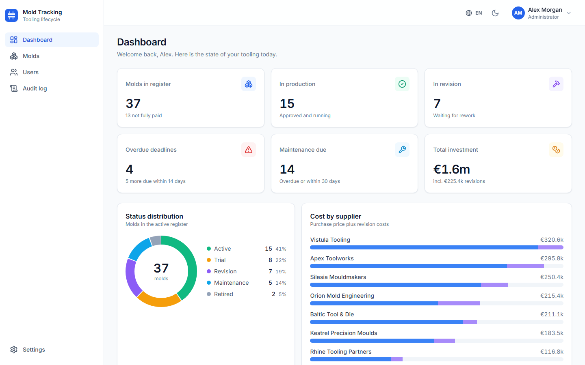
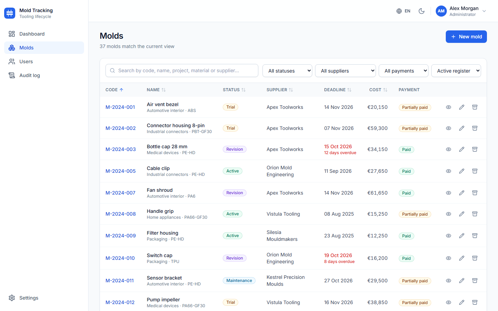
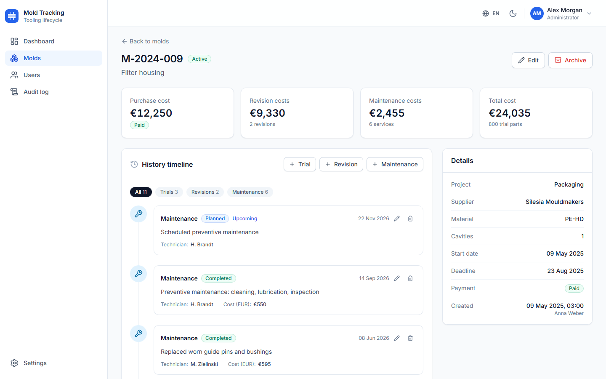
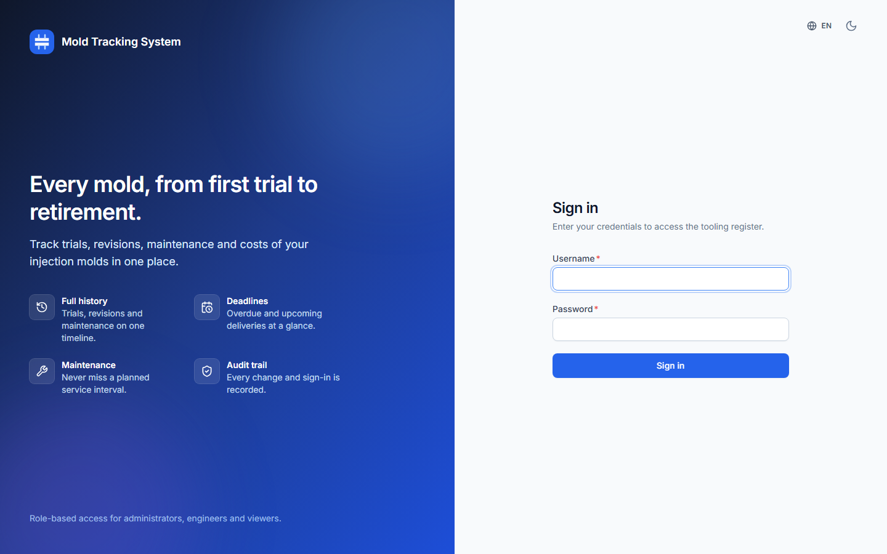
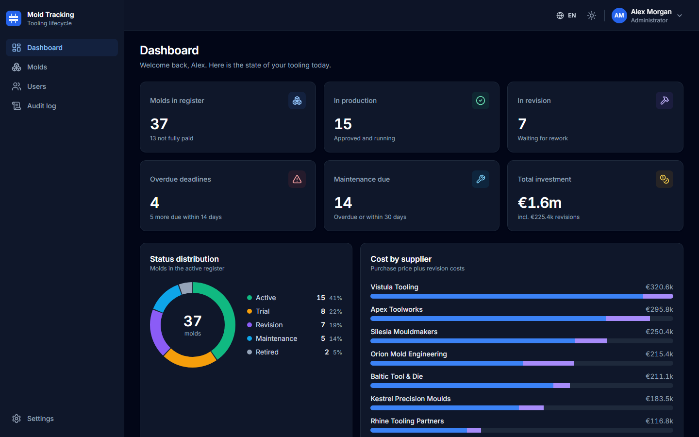

# Mold Tracking System

Track injection molds through their whole lifecycle: purchasing, trial runs, revisions and maintenance. A role-based REST API (**Node.js, Express, SQL Server**) with a polished **React** dashboard in English, German and Polish.

**[Live demo](https://arifaydin12.github.io/mold-tracking-system/)** - runs entirely in your browser with sample data (no backend needed). Sign in with `admin`, `engineer` or `viewer`; the password is shown on the login screen.



| | |
| --- | --- |
|  |  |
|  |  |

## Features

- **Mold register** with search, status / supplier / payment filters, sortable columns and pagination (state is kept in the URL)
- **Mold detail page** with a timeline of trial runs, revisions and maintenance, cost totals and add / edit / delete dialogs with validation
- **Dashboard**: KPI cards, status distribution, cost by supplier, upcoming deadlines, maintenance due and recent activity
- **Soft delete**: molds are archived, not destroyed; only an administrator can restore them
- **Roles**: `admin`, `engineer` and `viewer` (see the matrix below), enforced on the server for every route
- **User management**: create, edit, deactivate users and reset passwords; the last active administrator is protected
- **Audit trail**: every data change and every sign-in attempt (with IP and client) is recorded and can be browsed and filtered by administrators
- **Security**: bcrypt password hashes, short-lived access tokens plus rotating refresh tokens in an httpOnly cookie (reuse detection), login rate limiting, Helmet headers, strict CORS, input validation on every write
- **UI**: responsive, dark mode, English / German / Polish, toasts, skeleton loaders, empty and error states, keyboard accessible (no axe-core violations in light or dark theme)
- **API docs**: OpenAPI 3 document rendered with Swagger UI at `/api/docs`

## Architecture


```
  Browser (React SPA)                  Express API                                   SQL Server
 ┌───────────────────────┐  /api   ┌────────────────────────────────────┐  mssql  ┌──────────────────┐
 │ React 18, Vite        │ ──────> │ helmet, CORS, rate limits, cookies │ ──────> │ users            │
 │ Tailwind, i18next     │  JSON   │ routes > zod validation > JWT auth │         │ suppliers        │
 │ axios + token refresh │ <────── │ > permission check > controller    │ <────── │ molds            │
 └───────────┬───────────┘ Bearer  │ > service (SQL) > audit log        │         │ mold_trials      │
             │                     └────────────────────────────────────┘         │ mold_revisions   │
             │ VITE_DEMO=true                                                     │ mold_maintenance │
             v                                                                    │ refresh_tokens   │
   in-browser mock API: same routes, validation and roles,                        │ activity_logs    │
   data kept in localStorage (GitHub Pages demo)                                  │ login_logs       │
                                                                                  └──────────────────┘
```

| Layer | Technology |
| --- | --- |
| Frontend | React 18, Vite, Tailwind CSS, React Router, Axios, i18next, lucide-react (charts are plain SVG) |
| Backend | Node.js 22+, Express 4, `mssql`, `zod`, `jsonwebtoken`, `bcrypt`, Helmet, express-rate-limit |
| Database | Microsoft SQL Server (schema in `database/schema.sql`) |
| Tests | `node:test` + supertest against a real SQL Server, Vitest + Testing Library |

### Role matrix

| Capability | admin | engineer | viewer |
| --- | :-: | :-: | :-: |
| View molds, history, dashboard | yes | yes | yes |
| Create / edit molds, suppliers | yes | yes | - |
| Add / edit / delete trials, revisions, maintenance | yes | yes | - |
| Archive molds | yes | yes | - |
| Restore archived molds | yes | - | - |
| Manage users, read the audit log | yes | - | - |

### API overview

All routes live under `/api`. Errors always look like `{ "error": { "code", "message", "details?" } }`; lists return `{ "data": [...], "meta": { "page", "page_size", "total", "total_pages" } }`. The complete reference is in [`src/docs/openapi.yaml`](src/docs/openapi.yaml) (served at `/api/docs`).

| Method | Endpoint | Access |
| --- | --- | --- |
| GET | `/health` | public |
| POST | `/auth/login`, `/auth/refresh`, `/auth/logout` | public (login is rate limited) |
| GET / PATCH | `/auth/me` | signed in |
| POST | `/auth/change-password` | signed in |
| GET | `/molds` (`search`, `status`, `supplier_id`, `payment_status`, `archived`, `sort`, `order`, `page`, `page_size`) | all roles |
| POST | `/molds` | admin, engineer |
| GET | `/molds/:id` (includes history and cost totals) | all roles |
| PATCH / DELETE | `/molds/:id` (DELETE archives) | admin, engineer |
| POST | `/molds/:id/restore` | admin |
| GET / POST | `/molds/:id/trials`, `/revisions`, `/maintenance` | read: all, write: admin, engineer |
| PATCH / DELETE | `/molds/:id/trials/:recordId` (same for `revisions`, `maintenance`) | admin, engineer |
| GET / POST / PATCH | `/suppliers`, `/suppliers/:id` | read: all, write: admin, engineer |
| GET / POST / PATCH | `/users`, `/users/:id` | admin |
| POST | `/users/:id/reset-password` | admin |
| GET | `/stats/dashboard` | all roles |
| GET | `/logs/activity`, `/logs/logins` | admin |
| GET | `/docs`, `/docs/openapi.json` | public |

## Getting started

**Prerequisites:** Node.js 22 or newer and a SQL Server instance (2019+). The quickest way to get one is Docker:

```bash
docker run -d --name mold-sql -e ACCEPT_EULA=Y -e 'MSSQL_SA_PASSWORD=YourStrong!Passw0rd' -p 1433:1433 mcr.microsoft.com/mssql/server:2022-latest
```

1. **Install and configure**

   ```bash
   npm install
   cp .env.example .env        # Windows: copy .env.example .env
   ```

   Edit `.env`: set `DB_USER` / `DB_PASSWORD` for your SQL Server and a random `JWT_SECRET`
   (`node -e "console.log(require('crypto').randomBytes(48).toString('hex'))"`).
   Quote values that contain `#` (e.g. `DB_PASSWORD="pa#ss"`).

2. **Create the database and load demo data**

   ```bash
   npm run db:init      # creates the database named in DB_NAME and applies database/schema.sql
   npm run seed         # ~40 molds with trial / revision / maintenance history, suppliers, users, logs
   ```

   The seed creates the accounts `admin`, `engineer` and `viewer` (plus a few more) with the password from `SEED_PASSWORD`
   (default `Demo-2026`). It is meant for local development only and refuses to run when `NODE_ENV=production`.
   For a real installation create your first administrator instead:

   ```bash
   npm run create-admin -- admin "Your Name" "a-strong-password"
   ```

3. **Start the API** (http://localhost:5000, docs at http://localhost:5000/api/docs)

   ```bash
   npm start            # or: npm run dev   (auto-restart with nodemon)
   ```

4. **Start the dashboard** in a second terminal (http://localhost:3000, `/api` is proxied to port 5000)

   ```bash
   cd frontend
   npm install
   npm run dev
   ```

For production, run `npm run build` in `frontend/`, serve `frontend/dist` with any web server and reverse-proxy `/api` to the API (set `COOKIE_SECURE=true`, `TRUST_PROXY=true` and `CORS_ORIGINS` accordingly).

### Environment variables

| Variable | Default | Description |
| --- | --- | --- |
| `PORT` | `5000` | API port |
| `NODE_ENV` | `development` | `production` disables the seed and database reset scripts |
| `CORS_ORIGINS` | `http://localhost:3000,http://localhost:5173` | Comma-separated browser origins allowed to call the API |
| `TRUST_PROXY` | `false` | Set to `true` behind a reverse proxy (correct client IPs for rate limiting and logs) |
| `DB_SERVER`, `DB_PORT`, `DB_NAME` | `localhost`, `1433`, `MoldTracking` | SQL Server location and database |
| `DB_USER`, `DB_PASSWORD` | - | SQL Server login (required) |
| `DB_ENCRYPT`, `DB_TRUST_CERT` | `false`, `true` | TLS options for the connection |
| `JWT_SECRET` | - | Secret used to sign access tokens, at least 16 characters (required) |
| `ACCESS_TOKEN_TTL` | `15m` | Lifetime of the access token |
| `REFRESH_TOKEN_TTL_DAYS` | `7` | Lifetime of the rotating refresh token |
| `COOKIE_SECURE` | `false` | Adds the `Secure` flag to the refresh cookie (use with HTTPS) |
| `LOGIN_RATE_LIMIT_MAX`, `LOGIN_RATE_LIMIT_WINDOW_MIN` | `10`, `15` | Login attempts allowed per IP per window |
| `API_RATE_LIMIT_MAX` | `600` | General API requests per IP per minute |
| `SEED_PASSWORD` | `Demo-2026` | Password of the demo accounts created by `npm run seed` |
| `TEST_DB_NAME` | `MoldTrackingTest` | Database used (and wiped!) by `npm test` |

## Scripts

| Command | What it does |
| --- | --- |
| `npm start` / `npm run dev` | Start the API (dev restarts on changes) |
| `npm run db:init` | Create the database if missing and apply `database/schema.sql` (idempotent) |
| `npm run db:reset` | Drop all tables and recreate them (development only) |
| `npm run seed` | Load the demo dataset (`-- --force` wipes existing data first) |
| `npm run create-admin -- <user> "<name>" "<password>"` | Create an administrator |
| `npm test` | Backend integration tests |
| `npm run test:frontend` | Frontend unit tests (Vitest) |
| `npm run build:demo` | Build the static demo into `docs/` |
| `npm run seed:generate` | Regenerate `database/seed-data.json` (deterministic) |
| `npm run sync:demo-schemas` | Copy the server's zod schemas into the front end for the demo backend |

## Tests

```bash
npm test                 # 73 integration tests against a real SQL Server
npm run test:frontend    # 75 unit and component tests
```

The backend tests use the same connection settings as `.env` but a **separate database** (`MoldTrackingTest`, override with `TEST_DB_NAME`) that is dropped and recreated for every test file, so make sure it never points at data you care about. They cover authentication (refresh rotation and reuse detection, password change, deactivated accounts, login rate limiting), role enforcement on every kind of write, CRUD with validation, soft delete, pagination / filtering / sorting, the dashboard aggregation, audit and login logging, the seed script and graceful shutdown.

The frontend tests cover formatting and validation utilities, permissions, locale completeness (every key exists in all three languages), key components (accessible modal, pagination, charts, language switcher, toasts, pages) and the in-browser demo backend, including a check that its validation schemas are an exact copy of the server's.

## Live demo (GitHub Pages)

The demo in [`docs/`](docs) is a static build of the same React app with `VITE_DEMO=true`: axios is wired to an in-browser mock backend (`frontend/src/demo/`) that implements the same routes, zod validation, role rules, soft delete and audit log, seeded from the same `database/seed-data.json` and persisted in `localStorage`. A banner shows "Demo mode - data stays in your browser" and lets you reset the data.

Rebuild it with `npm run build:demo` (Vite `--mode demo`: relative asset paths, hash routing, output to `docs/`) and let GitHub Pages serve the `main` branch `/docs` folder.

## Project structure

```
src/
  app.js, server.js        Express app factory, startup and graceful shutdown
  config/                  Environment loading, role / permission matrix
  routes/, controllers/    HTTP layer
  services/                Business logic and SQL (molds, records, users, auth, stats, logs, audit)
  middleware/              Authentication, validation, rate limiting, error handling
  validation/schemas.js    zod schemas for every write and query string
  db/                      Connection pool, schema initialisation, seeding
  docs/openapi.yaml        API description served at /api/docs
database/                  schema.sql and the generated seed-data.json
scripts/                   db-init, seed, create-admin, generators
tests/                     Backend integration tests (node:test + supertest)
frontend/                  React application (Vite, Tailwind, Vitest)
  src/demo/                In-browser mock backend used by the static demo
docs/                      Generated static demo (GitHub Pages)
screenshots/               Images used in this README
```

## Security notes

- Secrets and database credentials come from environment variables; `.env` is git-ignored.
- Passwords are stored only as bcrypt hashes; refresh tokens only as SHA-256 hashes and are rotated on every use.
- The access token is kept in memory by the SPA; after a reload it is re-issued from the httpOnly refresh cookie (`SameSite=Lax`).
- Changing or resetting a password, deactivating a user or changing a role ends that user's refresh sessions; role and status changes apply to existing access tokens immediately because the user is reloaded on every request.
- The demo accounts and their password exist only in the seed data and in the public demo; do not run the seed against a production database.

## License

[MIT](LICENSE)
