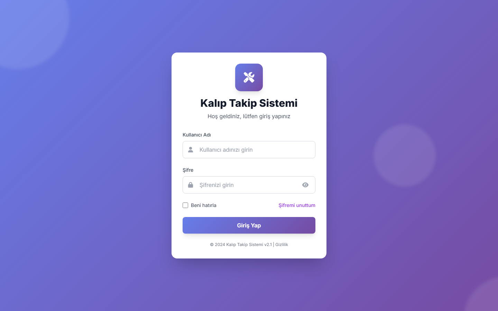

# Mold Tracking System

A full-stack application for tracking injection moulds through their whole lifecycle: purchasing, trial runs, revisions and maintenance. It has a role-based REST API on **Node.js, Express and SQL Server** and a **React** dashboard in three languages.



## Features

- **Mould register**: code, name, project, supplier, cavity count, material, cost, deadline and payment status
- **History per mould**: trial runs, revisions (supplier, work done, price, payment) and maintenance records
- **Dashboard** with live statistics, search and status filters
- **JWT authentication** with bcrypt-hashed passwords and 8-hour sessions
- **Roles**: administrators manage users and can delete moulds; regular users add and edit records
- **User management**: create and deactivate users, reset passwords, change your own password
- **Audit trail**: every create, update and delete is written to an activity log, and every login attempt is recorded
- **Three languages**: Turkish, English and German (i18next)

## Architecture

```
React (Vite, Tailwind)  --/api-->  Express REST API  -->  SQL Server
      frontend/                    controllers, routes,        schema in
                                   middleware (JWT, logs)      database/schema.sql
```

| Layer | Technology |
| --- | --- |
| Frontend | React 18, Vite, Tailwind CSS, Axios, i18next, lucide-react |
| Backend | Node.js, Express 4, `mssql`, `jsonwebtoken`, `bcrypt` |
| Database | Microsoft SQL Server |

### API overview

| Method | Endpoint | Access |
| --- | --- | --- |
| POST | `/api/auth/login` | Public |
| GET / POST | `/api/kaliplar` | Authenticated |
| PUT / DELETE | `/api/kaliplar/:id` | Authenticated (delete: admin only) |
| POST | `/api/deneme`, `/api/revizyon`, `/api/bakim` | Authenticated |
| POST | `/api/auth/change-password`, `/api/auth/logout` | Authenticated |
| GET / POST / PUT | `/api/kullanicilar`, `/api/kullanicilar/:id` | Admin |
| POST | `/api/kullanicilar/:id/reset-password` | Admin |
| GET | `/api/logs/aktivite`, `/api/logs/giris` | Admin |
| GET | `/api/stats/system` | Authenticated |

## Getting started

**Prerequisites:** Node.js 18+ and a SQL Server instance.

1. **Create the database**

   Run [`database/schema.sql`](database/schema.sql) in SQL Server Management Studio, `sqlcmd` or Azure Data Studio.

2. **Configure the backend**

   ```bash
   npm install
   cp .env.example .env     # on Windows: copy .env.example .env
   ```

   Edit `.env` and set your database credentials. Generate strong secrets with:

   ```bash
   node -e "console.log(require('crypto').randomBytes(48).toString('hex'))"
   ```

3. **Create the first administrator**

   ```bash
   npm run create-admin -- admin "Your Name" "a-strong-password"
   ```

4. **Start the API**

   ```bash
   npm start          # http://localhost:5000
   ```

5. **Start the dashboard** in a second terminal

   ```bash
   cd frontend
   npm install
   npm run dev        # http://localhost:3000, proxies /api to port 5000
   ```

## Project structure

```
server.js            Express app and route mounting
config/db.js         SQL Server connection pool
controllers/         Auth, moulds, users and logs
routes/              Route definitions
middleware/          JWT authentication, admin guard, activity logger
database/schema.sql  Tables for users, moulds, trials, revisions, maintenance, logs
scripts/             create-admin helper
frontend/            React dashboard (Vite)
index.html, login.html   Earlier static version of the UI (CDN React)
```

## Security notes

- Secrets and database credentials are read from environment variables; `.env` is git-ignored.
- Passwords are stored only as bcrypt hashes.
- The repository intentionally contains no database backups or default accounts.

## License

[MIT](LICENSE) © Arif Enes
